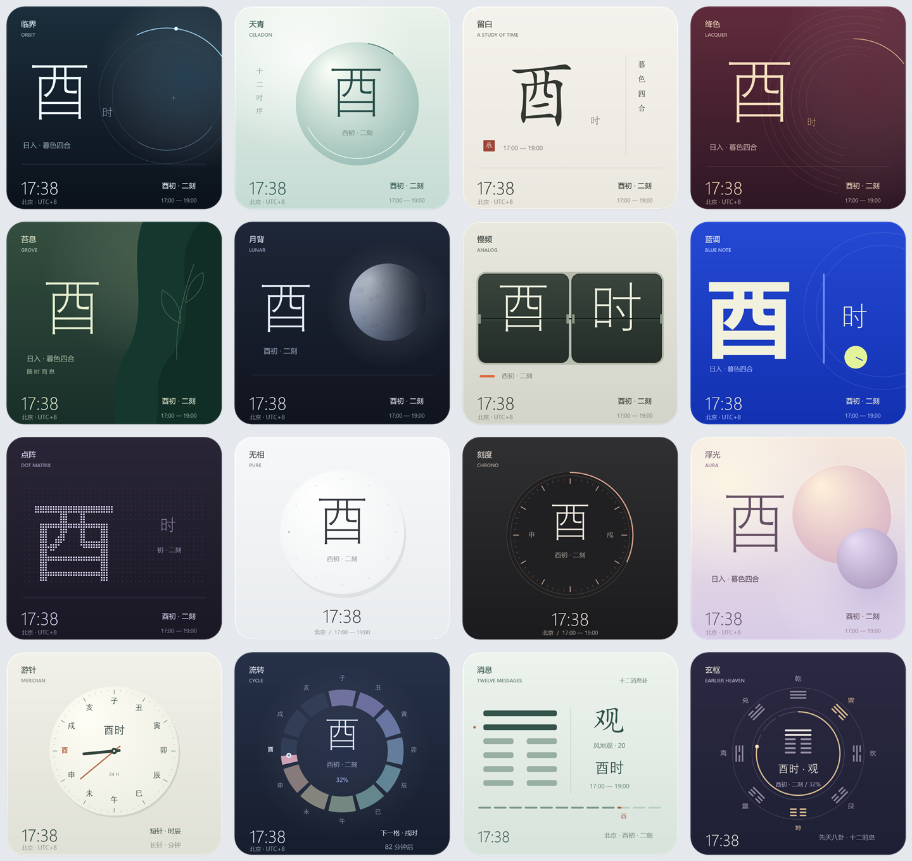

# 拾辰 · ShichenClock

一个以中国传统十二时辰显示时间的 Windows 桌面时钟，内置 14 套外观，支持四边吸附、平滑收起和鼠标移入展开。



## 下载使用（无需编译）

**[下载最新版 Windows 便携包](https://github.com/lzl-debug/ShichenClock/releases/latest)**

1. 在下载页的 **Assets** 中下载 `ShichenClock-v1.1.0-windows.zip`。
2. 将整个 ZIP 解压到固定文件夹。
3. 双击解压后的 `ShichenClock.exe` 即可运行。

适用 Windows 10 / 11，需要 .NET Framework 4.8。无需安装开发工具；日常运行无需联网。可以右键 EXE 创建桌面快捷方式。建议解压后运行，避免设置保存在压缩软件的临时目录中。

升级时先退出旧版，将新版解压到原文件夹并覆盖，保留 `settings.ini` 即可保留个人设置。详细步骤见 [快速开始](快速开始.txt)。

## 功能

- 按北京时间 UTC+8 显示十二时辰、初正和刻数。
- 14 套独立外观，包含科技、当代东方、宣纸、漆器、自然、月相、复古、平面构成、像素、极简、腕表和流体风格。
- 「游针」使用十二地支表盘，短针一天走一圈，长针显示分钟。
- 「流转」将一天分为 12 个环形区段，逐段显示当前时辰进度。
- 可见卡片四边紧贴屏幕，收起约 360 毫秒、展开约 300 毫秒，边缘细条支持直接移入唤出。
- 支持置顶、80% / 100% / 120% 大小、托盘找回和设置记忆。
- 原生 C# / WPF，离线运行，无需 Node.js、Python 或浏览器作为运行依赖。

## 构建与运行

需要 Windows 10 / 11 和 .NET Framework 4.8。克隆仓库后，在项目目录运行：

```powershell
powershell -NoProfile -ExecutionPolicy Bypass -File .\build.ps1
.\ShichenClock.exe
```

编译使用 Windows 随附的 .NET Framework C# 编译器。可执行文件在本地生成，不纳入源码仓库。

按住时钟主体拖动，靠近屏幕边缘松手后会吸附。鼠标移开约 0.85 秒后收起，移到边缘拉手上即可展开。鼠标移入时，右上角出现外观、置顶和更多操作按钮。

详细操作见 [使用说明](使用说明.md)。直接在浏览器打开 [风格预览](风格预览.html) 或 [动态表盘预览](动态表盘预览.html)，可浏览外观、拖动时间和加速演示。

## 验证

构建后运行：

```powershell
Start-Process .\ShichenClock.exe -ArgumentList '--self-test' -Wait
Start-Process .\ShichenClock.exe -ArgumentList '--smoke-test' -Wait
```

逻辑检查覆盖时辰边界、跨午夜、刻数、指针角度和环形区段切换。桌面检查覆盖全部外观、四个边缘与三种尺寸下的吸附和动画、途中反向、位置恢复及选择器。

`src/verify-preview.cjs` 是可选的预览页面检查脚本，需要 Node.js 18+、Playwright Core 和已安装的 Microsoft Edge；这些只用于开发验证。

## 目录

```text
src/                   C# 源码、图标、应用清单及开发辅助脚本
previews/              外观图片及总览
build.ps1              Windows 构建脚本
风格预览.html           离线外观画册
动态表盘预览.html       指针与环形时钟交互演示
使用说明.md             详细说明
```

本地设置、构建输出、验证产物和旧版备份由 `.gitignore` 排除。
